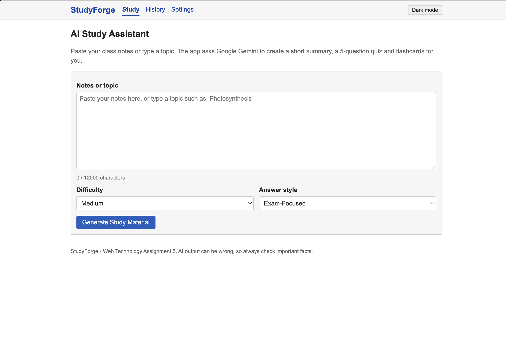

# StudyForge - AI Study Assistant

StudyForge is a small web app for students. You paste your class notes (or type a topic) and the app uses the
Google Gemini API to create:

1. a short summary,
2. a quiz with exactly five multiple-choice questions, and
3. flashcards you can flip and track.

It is built for **Web Technology Assignment 5** with only HTML5, basic CSS3 and vanilla JavaScript
(no frameworks, no build step, no backend). The design is a simple, Codeforces-inspired academic layout.

## Screenshot

`

## Features

- Notes/topic input with a live character counter, a warning near the limit (12,000 characters) and generation disabled when over the limit
- Difficulty selector (Easy / Medium / Hard) and answer style (Explain Like I'm 10 / Exam-Focused / Detailed)
- **Summary tab:** Copy, Download as TXT, Read Aloud and Stop Speaking (browser Speech Synthesis API)
- **Quiz tab:** exactly 5 questions, one answer each, score, correct answers and explanations, no double submit, Retake button
- **Quiz scores:** best score and recent scores saved in localStorage
- **Flashcards tab:** click or press Enter to flip (CSS flip effect), Known / Not Known tracking with a progress count, works on mobile
- **History:** saved in localStorage; search, reopen, regenerate, delete one item, Clear All with confirmation
- **Settings:** save / show-hide / clear your own API key (only the last 4 characters are ever displayed) and choose the model name
- Dark / Light mode saved in localStorage
- Handles empty input, missing key, 400/401/403/404/429/5xx errors, network failures, timeouts (60 s), blocked or empty AI replies, malformed JSON, invalid structure and corrupted localStorage

## Technologies used

- HTML5 (semantic elements, labels, ARIA roles for tabs and messages)
- CSS3 (CSS variables for themes, Flexbox, Grid, media queries)
- Vanilla JavaScript: DOM manipulation, events, arrays, objects, `async/await`, Promises, `fetch`, `AbortController`, JSON, `localStorage`, Clipboard API, Blob download, SpeechSynthesis API
- Google Gemini API (`generateContent` REST endpoint)

## Folder structure

```
studyforge/
├── index.html    page structure (header, Study, History, Settings)
├── style.css     simple styles + light/dark theme variables
├── script.js     all application logic
├── README.md     this file
└── .gitignore
```

## How to run locally

No installation is needed. Choose one way:

**Option A - open the file:** double-click `index.html`.

**Option B - small local server (recommended):**

```bash
cd studyforge
python3 -m http.server 8000      # on Windows you can use:  python -m http.server 8000
```

Then open <http://localhost:8000> in your browser.

## How to get a free Gemini API key

1. Go to <https://aistudio.google.com/apikey> and sign in with a Google account.
2. Click **Create API key** (pick or create a project when asked).
3. Copy the key. Treat it like a password.

Free-tier limits and available models can change. Check the official pages if something does not work:
<https://ai.google.dev/gemini-api/docs/rate-limits> and <https://ai.google.dev/gemini-api/docs/models>.

## How to save and use the key in the app

1. Open **Settings** in the top menu.
2. Paste your key and click **Save API Key**. The page then shows only `****` and the last 4 characters.
3. Go back to **Study**, paste notes and click **Generate Study Material**.

Use **Show** to check what you typed before saving, and **Clear API Key** to remove it.
The default model is `gemini-3.5-flash-lite`. If your key gets a "model not found" or quota error, type another
model name from the official model list (for example `gemini-3.8-flash`) in Settings and click **Save Model**.

## How the POST fetch request works

`callGeminiAPI()` in `script.js` sends this request:

```
POST https://generativelanguage.googleapis.com/v1beta/models/<model>:generateContent
Headers:  Content-Type: application/json
          x-goog-api-key: <your key>
Body:     { "contents": [ { "parts": [ { "text": "<prompt>" } ] } ],
            "generationConfig": { "responseMimeType": "application/json" } }
```

Step by step:

1. `buildPrompt()` creates the prompt text from the notes, difficulty and answer style.
2. `fetch()` sends a **POST** request with `JSON.stringify(body)`. The call uses `await`, so the code waits for the answer without freezing the page.
3. An `AbortController` cancels the request after 60 seconds.
4. If `response.ok` is false, `buildHttpError()` converts the HTTP status (400, 401, 403, 404, 429, 5xx) into a short message.
5. `extractTextFromResponse()` reads the text from `candidates[0].content.parts[].text` and checks for blocked prompts, safety stops, empty answers and cut-off answers.
6. A `finally` block always turns the loading state off, so the button never stays stuck.

Note: Google now describes `generateContent` as the "legacy" API and recommends its newer *Interactions API* for new
projects, but `generateContent` is documented as fully supported. It was chosen here because its request and response
format are simple and clearly documented, which makes it easier to explain.

## How JSON parsing and response validation work

AI output is never trusted. The code runs two steps:

1. `parseAIResponse(text)` uses `JSON.parse()`. If the model wrapped the JSON in Markdown fences or extra words, it removes them and tries again. If parsing still fails, the user sees "The AI reply was not valid JSON".
2. `validateStudyMaterial(data)` checks every field and type: a non-empty `summary`; exactly **5** questions; each question has text, options `A`-`D` and a `correctAnswer` that is one of `A`, `B`, `C`, `D`; at least one flashcard with `front` and `back`. The first problem found is reported (for example "Quiz question 3 is missing option C"). The function returns a clean copy of the data, and only that copy is rendered.

All text is placed on the page with `textContent`, never `innerHTML`, so HTML or scripts inside AI text cannot run.

## How localStorage is used

| Key | Contents |
| --- | --- |
| `studyforge_api_key` | your Gemini API key |
| `studyforge_model` | chosen model name |
| `studyforge_theme` | `light` or `dark` |
| `studyforge_history` | up to 30 saved generations (notes, summary, 5 questions, flashcards, difficulty, style, timestamp) |
| `studyforge_scores` | up to 20 quiz scores |

Every read goes through `readStorage()`, which uses `try/catch`, so corrupted data or a browser that blocks storage
does not crash the app. Invalid history items are skipped, and the rest still work.

## API key security limitations (please read)

- This is a frontend-only project, so the key is stored in the browser's **localStorage**, and the browser sends it directly to Google.
- **localStorage is not secure storage.** Anyone who can use your browser, open its developer tools, or run a script on the page (for example through a browser extension or a future XSS bug) can read the key.
- On a public website, **each visitor must use their own key.** Never put your personal key in the source code, README, GitHub repository or a deployed page.
- Do not use a shared or public computer. Click **Clear API Key** when you finish.
- For real products, the key should stay on a server (a backend or serverless function) and the browser should talk to that server instead. That is outside the scope of this assignment.
- If a key is ever exposed, delete it in Google AI Studio and create a new one.

## How to deploy on Netlify or Vercel

The project is static (no build step).

**Netlify (easiest):**
1. Push the project to GitHub (see below).
2. In Netlify choose **Add new site -> Import an existing project**, select the repo.
3. Leave the build command empty and set the publish directory to `.` (the project root). Deploy.
   (Alternatively, drag and drop the folder onto <https://app.netlify.com/drop>.)

**Vercel:**
1. In Vercel choose **Add New -> Project** and import the GitHub repo.
2. Framework preset: **Other**. Leave build command and output directory empty. Deploy.

After deploying, open the site, go to **Settings**, paste your own key and generate something. Without a key you
should see the message "No API key saved", which confirms that errors are displayed correctly.

## Upload to GitHub

```bash
cd studyforge
git init
git add .
git commit -m "StudyForge: AI study assistant"
git branch -M main
git remote add origin https://github.com/<your-username>/studyforge.git
git push -u origin main
```

Before you push, check that no key is in the files (this prints nothing when the project is clean):

```bash
grep -rn "AIza" .
```

## Testing instructions

Manual checklist (about 10 minutes):

1. Open the page. The browser console (F12) should show no errors.
2. Click Generate with empty input -> "Please paste your notes" appears. Type text and click Generate with no key -> "No API key saved" appears.
3. Save a wrong key (for example `abc123`) and generate -> a clear "API key is not valid / rejected" message appears and the button works again.
4. Save your real key and generate with a short topic such as `Photosynthesis`. Check that a summary, **5** quiz questions and flashcards appear.
5. Quiz: leave a question blank and submit (you are asked to answer all); answer all and submit; check the score, green/red answers and explanations; press Submit again (nothing changes); click Retake Quiz. Reload the page and confirm the score is still listed.
6. Flashcards: click a card to flip it, use Known / Not Known / Next / Previous and watch the progress line.
7. Summary: test Copy, Download as TXT, Read Aloud and Stop Speaking.
8. Change Difficulty and Answer style, generate again, and compare the results.
9. History: reload the page, open History, search, Open an item, Regenerate an item, Delete one item, and try Clear All (cancel, then confirm).
10. Toggle Dark mode, reload and check that it is remembered. Check all pages in both modes.
11. Paste more than 12,000 characters: a warning appears and Generate is disabled.
12. Turn off your internet (or use browser dev tools -> Network -> Offline) and generate -> "Network problem" appears.
13. Resize the window (or use dev tools device mode) to phone, tablet and desktop widths.

## Known limitations

- The key is stored in localStorage, which is not secure (see above).
- AI answers can be wrong or inconsistent. If the AI breaks the JSON format or returns a different number of questions, you get an error and must click Generate again.
- Free-tier quotas and model names can change. If the default model is rejected, change it in Settings.
- Input is limited to 12,000 characters. Very long notes should be split.
- Read Aloud depends on the voices installed in the browser/OS, and some browsers do not support it.
- localStorage holds about 5 MB per site, so history is limited to the 30 newest items.
- Text only: no images, PDFs or file uploads.
